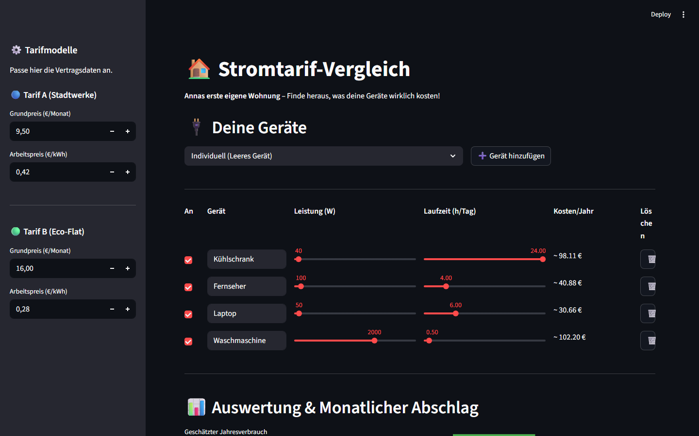
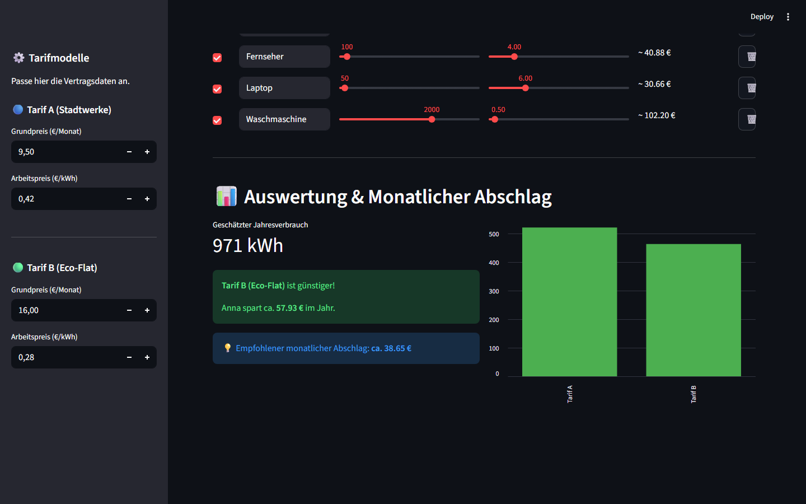

# Tarifvergleich Physik by JStudios

[-7656b5.svg)](https://jstudios.pages.dev/projects/tarifvergleich-physik/)
[](https://www.python.org/)
[](https://streamlit.io/)
[](https://jstudios.pages.dev/projects/tarifvergleich-physik/)
[](LICENSE)

**Vom Geräteverbrauch zum jährlichen Strompreis.**

[Projektseite](https://jstudios.pages.dev/projects/tarifvergleich-physik/) · [Lizenz](LICENSE) · Lernwerkzeug

Ein interaktives Physik-Lernwerkzeug für zwei Stromtarife. Leistung, tägliche Laufzeit, Grundpreis und Arbeitspreis lassen sich verändern; Verbrauch, Jahreskosten und monatlicher Abschlag werden automatisch berechnet.

## Hintergrund

Statt Stromverbrauch nur abstrakt mit Formeln zu berechnen, lässt sich ein Beispielhaushalt aus mehreren Geräten zusammenstellen. Damit werden der Unterschied zwischen Leistung und Energie sowie der Zusammenhang von Grund- und Arbeitspreis direkt sichtbar.

## Vorschau

### Geräte und Tarife



*Aktive Beispielgeräte, Laufzeiten und einstellbare Tarifparameter.*

## Funktionsumfang

### Geräte modellieren

Geräte mit Leistung in Watt und Laufzeit pro Tag erfassen; Vorlagen oder individuelle Werte verwenden.

### Verbrauch berechnen

Tägliche Energie in kWh aus Leistung × Laufzeit / 1000. Aktive Geräte addieren, anschließend auf 365 Tage hochrechnen.

### Zwei Tarife vergleichen

Jahresverbrauch × Arbeitspreis plus zwölf Monatsgrundpreise. Die günstigere Variante und die mögliche Ersparnis werden hervorgehoben.

### Abschlag abschätzen

Die Jahreskosten werden durch zwölf geteilt. Ein Balkendiagramm stellt die Gesamtkosten beider Tarifmodelle gegenüber.

## Beispiel und Bedienung

Die Standardbeispiele Kühlschrank, Fernseher, Laptop und Waschmaschine ergeben 2,66 kWh pro Tag bzw. 970,9 kWh pro Jahr. Tarif A: 9,50 €/Monat und 0,42 €/kWh; Tarif B: 16 €/Monat und 0,28 €/kWh. Damit ergeben sich 521,78 € bzw. 463,85 € pro Jahr (auf Cent gerundet), also rund 57,93 € Unterschied. Es handelt sich ausschließlich um Modellwerte.

1. **Haushalt zusammenstellen:** Geräte aktivieren, ergänzen, entfernen und Laufzeiten ändern.
2. **Tarifparameter einsetzen:** Monatlichen Grundpreis und Arbeitspreis je kWh für beide Varianten eingeben.
3. **Auswertung vergleichen:** Jahresverbrauch, Kosten und monatlichen Abschlag betrachten.

### Verbrauch und Kosten



*Jahresverbrauch, Tarifvergleich und monatlicher Modellabschlag.*

## Technische Eckdaten

Python · Streamlit · pandas

| Bereich | Beschreibung |
| --- | --- |
| Energie pro Tag | P in W × t in h / 1000 |
| Jahresverbrauch | Tagesverbrauch × 365 |
| Jahreskosten | kWh × Arbeitspreis + 12 × Grundpreis |
| Monatsabschlag | Jahreskosten / 12 |

## Installation unter Windows

Python und pip installieren.

```powershell
git clone https://github.com/byJStudios/tarifvergleich-physik.git
cd tarifvergleich-physik
python -m venv .venv
.venv\Scripts\python.exe -m pip install -r requirements.txt
.venv\Scripts\python.exe -m streamlit run app.py --server.address 127.0.0.1
```

Alternativ das Repository als ZIP herunterladen und entpacken. Die lokale Browseradresse wird von Streamlit im Terminal angezeigt. Keine realen Daten in den Repository-Ordner einchecken.

## Projektstatus, Datenschutz und Grenzen

Didaktisches Modell mit konstanten täglichen Laufzeiten. Keine aktuellen Marktpreise, Verbrauchsmessung, dynamischen Tarife, Tarifberatung oder tatsächlichen Abschlagszusagen. Gerätepreise berücksichtigen den günstigeren Arbeitspreis, nicht anteilige Grundkosten. Die fiktiven Standardwerte wurden in der Anwendung überprüft.

## Lizenz

Eigener Quellcode wird ab diesem Lizenzwechsel unter der [PolyForm Noncommercial License 1.0.0](LICENSE) angeboten (Source-Available, nicht OSI-Open-Source). Frühere Veröffentlichungen werden nicht mehr angeboten; bereits wirksam erteilte Rechte bleiben unberührt.

Drittkomponenten behalten ihre jeweiligen Lizenzen: Streamlit (Apache-2.0), pandas (BSD-3-Clause). Sie werden separat installiert; die neue Lizenz beansprucht keine Rechte an Drittsoftware, Marken oder Inhalten Dritter. JStudios-Branding und eigene Gestaltungselemente sind nicht pauschal zur Nutzung freigegeben.

JStudios behält sich vor, Nutzungen außerhalb der jeweils geltenden Lizenz und gesetzlicher Erlaubnisse rechtlich zu verfolgen. Für gesonderte kommerzielle Nutzungsrechte: [jstudios.development@gmail.com](mailto:jstudios.development@gmail.com).

© 2026 Julian Schmitz / JStudios
